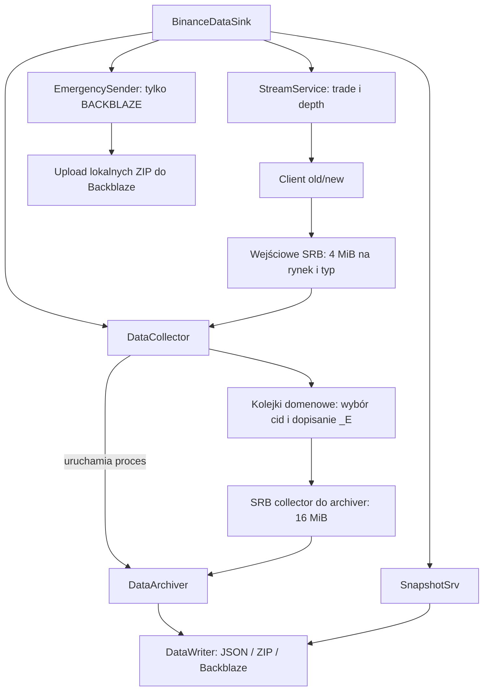
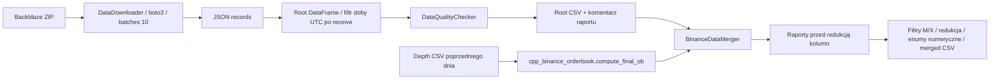

# MAP.md — mapa kodu i kontraktów

Stan na **2026-10-24**: lokalny working tree, włącznie ze zmianami staged/unstaged i plikami nieśledzonymi. Zasady pracy: [AGENTS.md](AGENTS.md). Priorytety, wyniki i kryteria napraw: [PROJECT_STATE.md](PROJECT_STATE.md). Kod jest źródłem prawdy; podłączenie ścieżki nie oznacza potwierdzonej integracji.

Ścieżki kodu poniżej są względem `binance_data_processor/`, chyba że wskazano root. Zacznij od tabeli zadania; dalsze sekcje są referencją do czytania według potrzeb.

<a id="zadanie"></a>

## Zmieniasz X — sprawdź też Y

| Zadanie | Zacznij tutaj | Sprawdź też | Kontrakt / backlog |
| --- | --- | --- | --- |
| Start, stop, awaria procesu | `data_sink/data_sink_facade.py` | `core/data_collector.py`, `core/archive_worker.py`, `core/stream_srv.py`, `core/snapshot_srv.py`, `core/emergency_sender.py` | [Online](#online); P0-04, P2-09 |
| Odbiór i timestampy | `core/client.py` | `core/url_factory.py`, `utils/time_utils.py`, obie kolejki domenowe | [Czas](#czas); P0-03, P2-07 |
| Rotacja WS, subskrypcje | `core/stream_srv.py` | `core/queue_flags_pool.py`, `core/data_collector.py`, `core/trade_queue.py`, `core/difference_depth_queue.py`, `core/client.py` | [Transport](#transport); P0-02, P2-08 |
| SRB, pełny bufor, akceptacja cid | `core/shared_ring_buffer.py`, `core/queue_pool.py` | Client, collector, archiwizer, obie kolejki domenowe | [Transport](#transport); P0-03/04 |
| Zapis, rotacja plików, upload | `core/archive_worker.py`, `core/data_writer.py` | Collector, `core/emergency_sender.py`, `cloud_storage_clients/s3_client.py`, `utils/file_utils.py`, prefixy downloadera | [Offline](#offline); P0-01, P2-01/06 |
| Snapshoty REST | `core/snapshot_srv.py` | URLFactory, DataWriter, fasada sinka, timestampy i pozycjonowanie snapshotu w mergerze | [Czas](#czas), [merger](#merger); P1-01, P2-05 |
| Listener / observer | `listener/listener_facade.py` | `core/listener_whistleblower.py`, `core/abstract_base_classes.py`, QueuePool, StreamService, SnapshotSrv | Ścieżka niespójna; P1-02 |
| API / CLI | `core/api_srv.py`, `core/cli.py` | Fasada sinka, `enums/cmd_reg_enum.py`, kanał komend między procesami | Odłączone, brak LightApi; P1-03, P2-04 |
| Konfiguracja, nowa para lub rynek | `enums/data_sink_cfg.py`, `enums/instruments_matrix.py`, `enums/time_cfg.py`, `enums/save_target_enum.py` | QueuePool, QueueFlagsPool, URLFactory, procesy i kody enumów konsumenta C++ | [Konfiguracja](#konfiguracja); P1-04/07, P2-08 |
| Archiwum do root CSV | `scraper/scraper.py`, `scraper/data_downloader.py` | `scraper/scraper_config.py`, `utils/file_utils.py`, `utils/time_utils.py`, jakość | [Offline](#offline); P2-01/03 |
| Scalanie / order book / format CSV | `scraper/orderbook_csv_concatenator.py` | `scraper/concatenator_config.py`, downloader, `enums/{market,stream_type,symbol}_enum.py`, zewnętrzny C++ | [Merger](#merger); P1-05/06/09, P2-02 |
| Reguły i raport jakości | `data_quality/individual_column_checker.py`, `data_quality/data_quality_checker.py`, `data_quality/data_quality_report.py` | Downloader i etap raportowania w mergerze; `test/test_data_quality_checker.py`, `test/test_csvs/` | [Jakość](#jakosc); P1-08/09 |
| Testy kolejek | `test/test_trade_queue.py`, `test/test_difference_depth_queue.py` | Kontrakty pustego odczytu, `_instances`, właściciel SRB i cleanup | [AGENTS.md](AGENTS.md); P1-10 |
| Import, instalacja, uruchomienie przykładu | `__init__.py`, `utils/sys.py`; root: `setup.py`, `requirements*.txt` | `bin/*.py`, `stock_data_sink_configs/*.json`; root: `Dockerfile`, `docker-compose.yml`, `.github/workflows/*.yml` | P1-11, P2-11 |

Pozostałe obszary: `continuity_registry/*.py` — ręczny rejestr START/STOP/ERROR i wykres, bez automatycznego spięcia z sinkiem (P2-10); `cloud_storage_clients/b2_client.py` — alternatywny klient niewpięty do writera; `core/setup_logger.py` — logi i lifecycle handlerów (P2-09). Rootowy `copy_to_clipboard.py`, `core/logo.py` i `core/spinning_donut.py` są pomocnicze.

## Publiczne punkty wejścia

Eksporty sprawdzaj w `__init__.py`: `launch_data_sink(cfg)`, `launch_data_listener(cfg, observers=None)`, `download_csv_data(cfg: ScraperCfg)`, `make_merged_csvs(cfg: DataConcatenatorConfig)`. Dwie funkcje `conduct_data_quality_analysis_on_*` przyjmują katalog albo listę ścieżek i wyświetlają interaktywny raport. README zawiera także stare wywołania.

<a id="online"></a>

## Aktywny przepływ online



- Fasada wymusza `spawn`, uruchamia kolektor, czeka 3 s i uruchamia stream oraz snapshot; retry ZIP tylko dla BACKBLAZE. Affinity: CPU 12 dla stream i CPU 6 dla kolektora/snapshot/retry. Uchwyty tych procesów są lokalne w `run()`; `stop()` ustawia wspólny event i czeka 5 s.
- `DataCollector` tworzy QueuePool, w `run()` uruchamia archiwizer, czyta do 64 rekordów na kolejkę przez `_drain_client_srb`, potem przekazuje zaakceptowane wiadomości przez `_forward_to_arch_srb`. Usuwa element deque dopiero po skutecznym zapisie do drugiego SRB. Pętla działa także przy pustych wejściach (busy-spin).
- `DataArchiver` grupuje po rynku, streamie i parze z pola `stream`, buduje tablice JSON i wywołuje `DataWriter.save_data`. Rotacja używa `time.monotonic()` i `file_duration_seconds`; nazwa pochodzi z UTC w chwili flush. Po pustym payloadzie (sentinel) następują końcowy flush i zamknięcie writera/uchwytu SRB; collector wykonuje join i usuwa swój segment.
- **Otwarte granice przepływu:** brak mostu flag rotacji w collectorze, ignorowane odrzucenia SRB w Client i brak potwierdzenia końca wszystkich producentów przed drain. Szczegóły, dowody i kryteria napraw są w P0-01–04 w `PROJECT_STATE.md`.

API/CLI są odłączone od sinka, a listener używa niespójnych interfejsów. Nie ma źródeł `core/light_api.py`, `core/srb_reader.py` ani `core/pipe_queue.py`; import API nadal odwołuje się do LightApi. Nie przywracaj dawnych modułów na podstawie historycznych opisów.

`core/archive_worker.py` jest aktywnie importowany, lecz na dzień przeglądu pozostaje nieśledzony w Git. Rootowych `sync_binance_clock.py`, `sync_binance_clock2.py` i `test_sync_binance_clock.py` nie ma; ich opis i pomiary są historyczne w `PROJECT_STATE.md`.

<a id="transport"></a>

## Transport i kolejki

| Granica | Kontrakt |
| --- | --- |
| Client → collector | `client_to_collector_tq_<MARKET>` i `client_to_collector_dq_<MARKET>`, po 4 MiB; nazwy globalne, bez izolacji instancji |
| Collector → archiver | `collector_to_archiver_<uuid>`, 16 MiB; payload `MARKET\nSTREAM_TYPE\n<JSON>`, cid/ts=0, odbiór w `_E`; pusty payload kończy strumień |
| Pamięć SRB | `16 + capacity`: uint64 LE write_pos w [0:8], read_pos w [8:16], dane od [16:]; capacity jest potęgą 2 i ≥16 |
| Rekord SRB | `<BQI>` (13 B): cid, timestamp, długość UTF-8, potem payload; nagłówek i payload mogą zawijać się na końcu pierścienia |
| Odczyt SRB | `get_nowait() -> (cid, ts, msg) \| None`; `qsize()` liczy bajty |
| Zapis SRB | `put_nowait(msg, ts, cid) -> bool`; False przy braku miejsca lub za dużym rekordzie |
| Kolejka domenowa | `put(msg, ts, cid)` filtruje cid i dopisuje `_E`; `get/get_nowait` robi `deque.popleft()`, więc pusty odczyt rzuca `IndexError`; `qsize()` liczy wiadomości |

Picklowanie SRB przenosi nazwę i capacity; odbiorca robi attach. Obie strony muszą uzgodnić capacity. Brak formalnej gwarancji atomowości/porządku pamięci między platformami; nie rozszerzaj modelu do niezależnych producentów bez synchronizacji. Klienci old/new zapisują synchronicznie w jednym event loop.

Kolejki startują z `accepted_cid=False`, `not_accepted_cid=True` i domenową flagą bool `did_ws_switch`. Limit trzech instancji każdej klasy opiera się na silnych referencjach `_instances`; `clear_instances()` nie zwalnia zasobów OS. `TradeQueue.clear()` istnieje, depth nie ma tej metody. `global_queue` zastępuje `srb`, lecz zaakceptowane wiadomości nadal trafiają do lokalnej deque. Kolejki mają `close/unlink`, ale collector ich nie wywołuje; `Client.close()` nie zamyka wejściowego SRB.

**Zamierzony handshake:** StreamService uruchamia przeciwny cid i ustawia event `set_switching_ws_mode`; collector przełącza strategię kolejki, a po dopasowaniu przenosi jej bool `did_ws_switch` do eventu; StreamService zamyka starego klienta. `QueueFlagsPool.get_flags` zwraca `QueueFlags` z dwoma `mp.Event`. Obecnie mostu w collectorze brak, a StreamService po sukcesie przypisuje `did_ws_switch = False` zamiast wyczyścić event (P0-02).

Trade porównuje kolejne podpisy `"s":"SYMBOL","t":TRADE_ID` regexem; samo dopasowanie nie wymaga różnych cid. Depth usuwa pole `E`, trzyma per cid `deque(maxlen=pairs_amount)`, wymaga wszystkich różnych streamów i identycznej kolejności sekwencji. Zmianę algorytmu rozpatruj razem z flagami, resetem po rotacji i aktualizacją par.

<a id="konfiguracja"></a>

## Konfiguracja i skutki konstruktorów

```python
from binance_data_processor import DataSinkCfg
from binance_data_processor.enums.instruments_matrix import InstrumentsMatrix
from binance_data_processor.enums.time_cfg import TimeCfg
from binance_data_processor.enums.save_target_enum import SaveTarget

# Przykład aktualnego typu konfiguracji; nie jest deklaracją sprawnego zapisu.
cfg = DataSinkCfg(
    instruments=InstrumentsMatrix(spot=["BTCUSDT"]),
    time=TimeCfg(file_duration_seconds=300,
                 snapshot_interval_seconds=60,
                 ws_lifetime_seconds=21600),
    save_target=SaveTarget.JSON,
    save_path="./dump",
    show_logo=False,
)
```

- `DataSinkCfg` wymaga `instruments`, `time`, `save_target`; opcjonalnie `blob_conn_params`, `save_path='../dump/'`, `show_logo=True`. Konstruktor tworzy katalog względem CWD.
- Przekazuj obiekty `InstrumentsMatrix`, `TimeCfg`, `SaveTarget`. Dataclass nie konwertuje słowników ani stringowego targetu; writer dopasowuje enumy i rzuca `ValueError` dla nieobsługiwanego celu, także stringa `'json'`.
- `InstrumentsMatrix.dict` mapuje `Market` na listy symboli. Puste rynki nie są inicjalizowane. Dodawanie par nie tworzy automatycznie transportu, procesu i flag nowego rynku.
- Poprawne nazwy pól `TimeCfg`: `file_duration_seconds`, `snapshot_interval_seconds`, `ws_lifetime_seconds`. `update_interval()` nadal ma stare nazwy w whitelist.
- `BlobConnParams` czyta `BACKBLAZE_ACCESS_KEY_ID`, `BACKBLAZE_SECRET_ACCESS_KEY`, `BACKBLAZE_ENDPOINT_URL`, `BACKBLAZE_BUCKET_NAME`. Nie ładuje sam `.env`. Aktualne cele: JSON, ZIP, BACKBLAZE, LISTEN_ONLY_FOR_TEST_PURPOSES; ostatni nie ma gałęzi w writerze. Nie ma aktualnego klienta Azure Blob.
- `ScraperCfg`: zakres dat, pary, rynki, streamy, `dump_path`; `skip_existing=True`, `verbose=False`. Zakres jest domknięty z obu stron.
- `DataConcatenatorConfig`: dodatkowo grupowanie par/rynków i katalog źródłowy. Domyślne pola z końcowym przecinkiem są obecnie tuple — patrz backlog.
- Obie konfiguracje CSV wywołują `prepare_dump_path_catalog()`, które tworzy katalog i otwiera Explorer przez `os.startfile`. Nie są to czyste obiekty danych; na innych OS ta funkcja nie jest dostępna.
- Stock JSON-y używają historycznego układu pól; brak aktywnego loadera dopasowującego je do dataclassów.

<a id="czas"></a>

## Kontrakty czasu i surowych danych

| Źródło | Jednostka przechowywana | Pola lokalne |
| --- | --- | --- |
| SPOT WebSocket trade/depth | mikrosekundy (US), URL zawiera `timeUnit=microsecond` | `_E` na poziomie wrappera |
| USD-M / COIN-M WebSocket | milisekundy (MS) | `_E` na poziomie wrappera |
| REST snapshot każdego rynku, także SPOT | milisekundy (MS) | `_rq` przed requestem, `_rc` po otrzymaniu odpowiedzi |
| Scalony CSV | `TimestampOfReceiveUS` w mikrosekundach | normalizacja MS × 1000; snapshoty są pozycjonowane względem depth |

`TimestampedConnection` w `core/client.py` pobiera lokalny UTC przy `data_received` i przypisuje wiadomości czas jej końcowego fragmentu; wspólny batch może mieć wspólny timestamp. Windows używa `GetSystemTimePreciseAsFileTime`, inne platformy `time.time_ns`. Nie ma integracji z wirtualnym zegarem Binance. Funkcje `round_epoch_ns_to_us/ms` w `utils/time_utils.py` zaokrąglają do najbliższej jednostki, nie obcinają. Daty wejściowe `DD-MM-YYYY`, doby i nazwy blobów są UTC. Nie używaj lokalnej strefy Europe/Warsaw do podziału archiwów. `resolve_epoch_time_unit()` obsługuje podstawowe streamy; nie zakładaj automatycznie poprawnej obsługi każdego nowego typu, np. `FINAL_DEPTH_SNAPSHOT`.

Surowy stream: `{"stream":"btcusdt@trade","data":{...},"_E":...}`. Archiwum streamu jest tablicą takich obiektów. REST snapshot jest pojedynczym obiektem `lastUpdateId/bids/asks/.../_rq/_rc`. Dopisywanie tekstem zakłada kompaktowy JSON zakończony `}`; regexy dodatkowo zakładają określoną kolejność pól i brak spacji.

`URLFactory` wybiera `stream.binance.com`, `fstream.binance.com`, `dstream.binance.com`; suffix `@trade` lub `@depth@100ms`. Zapisane w kodzie limity snapshotów: SPOT 5000, futures 1000. To opis implementacji, nie weryfikacja aktualnej dokumentacji giełdy.

<a id="offline"></a>

## Pliki, storage i pipeline offline

| Rodzaj | Wzorzec nazwy |
| --- | --- |
| Surowy JSON/ZIP / klucz blob | `binance_{stream_type}_{market}_{pair}_{DD-MM-YYYYTHH-MM-SSZ}.{json|zip}` |
| Root CSV | `binance_{pair}_{market}_{stream_type}_{YYYY-MM-DD}.csv` |
| Merged CSV | `binance_merged_{posortowane_pary}_{posortowane_rynki}_{YYYY-MM-DD}.csv` |

Nazwy tworzy `utils/file_utils.py`; enumy i pary w nazwach są lowercase. ZIP zawiera JSON z tym samym basename. Fixture testowe używają także starszych nazw; nie są wzorem obecnego outputu. Raporty jakości poprzedzają nagłówek CSV w liniach `#`; czytaj je przez `pd.read_csv(..., comment='#')`.

Writer: JSON lub ZIP lokalnie; BACKBLAZE kompresuje w RAM i wysyła przez `cloud_storage_clients.S3Client` (requests, ręczny SigV4). Pięć prób, po 5 s pomiędzy; potem fallback do lokalnego ZIP. `EmergencySender` jest uruchamiany dla BACKBLAZE, dosyła lokalne ZIP-y i usuwa je po udanym wywołaniu uploadu. JSON/ZIP używają trybu `x`; lokalne błędy zapisu propagują się. `B2Client` to inny, niewpięty klient; jego lifecycle nazywa się `shutdown`, a nie `stop`.



Scraper generuje iloczyn par × rynków × streamów × dni. Dla COIN-M zamienia np. `BTCUSDT` na `btcusd_perp` przez usunięcie ostatniego `T` i dodanie `_perp`; nie jest to ogólny resolver instrumentów. `skip_existing` porównuje `AssetParams` z nazw lokalnych plików.

Downloader szuka prefixu danego dnia oraz prefixu następnego dnia `T00-0` (00:00–00:09), aby uwzględnić zapis paczki po północy. Pobiera w partiach po 10 wątków, scala wyniki według indeksów plików i filtruje `TimestampOfReceive` do żądanej doby. Liczba 10 jest stałą modułu, nie polem configu. Trwałe błędy downloadu są ponawiane bez limitu. Listowanie błędów może zwrócić niepełny zestaw. Długie okno pliku może wykraczać poza założenie prefixu kolejnego dnia.

### Schemat root CSV

| Typ | Pola wspólne i różnice |
| --- | --- |
| Trade | `TimestampOfReceive, Stream, EventType, EventTime, TransactionTime, Symbol, TradeId, Price, Quantity, IsBuyerMarketMaker`; SPOT: `MUnknownParameter`, futures: `XUnknownParameter` |
| Depth diff | `TimestampOfReceive, Stream, EventType, EventTime, Symbol, FirstUpdateId, FinalUpdateId, IsAsk, Price, Quantity`; futures dodają `TransactionTime, FinalUpdateIdInLastStream`; COIN-M także `PSUnknownField` |
| Snapshot | `TimestampOfReceive, TimestampOfRequest, LastUpdateId, IsAsk, Price, Quantity`; futures dodają `MessageOutputTime, TransactionTime`; COIN-M także `Symbol, Pair` |

Depth i snapshot są rozwijane do jednego wiersza na poziom cenowy. `IsAsk=0` bid, `1` ask. **Quantity=0 w depth oznacza usunięcie poziomu**, a nie wadliwy rekord. Trade ma jeden wiersz na zdarzenie. Downloader trzyma Price/Quantity jako tekst; walidacja robi kopię z floatami. `read_csv` w mergerze może już wnioskować float — nie deklaruj gwarancji dokładności dziesiętnej.

<a id="merger"></a>

### Merger i kontrakt z C++

`make_merged_csvs` najpierw próbuje zapewnić root CSV od dnia poprzedzającego zakres. Nawet przy istniejących CSV powstaje `DataDownloader`, więc publiczna ścieżka nadal wymaga konfiguracji storage. `cpp_binance_orderbook` nie ma w repo ani deklarowanych zależnościach; jego `compute_final_ob(path)` zwraca obiekt z `bids()/asks()`, a wpisy mają `timestamp_of_receive`, `symbol.name`, `is_ask`, `price`, `quantity`.

Kolejność operacji:

1. Grupowanie według daty, rynku i pary, zależnie od flag join.
2. Wyliczenie `FINAL_DEPTH_SNAPSHOT` z depth poprzedniego dnia; obecny kod wymaga co najmniej 100 wierszy i 10 kolumn wyniku po wzbogaceniu.
3. Wczytanie depth/trade i **tylko pierwszego snapshotu dnia** (`TimestampOfReceive == iloc[0]`).
4. Dodanie `Market`, `StreamType`, `ServiceId`, `IsLast` i `TimestampOfReceiveUS`.
5. Sortowanie depth/trade po `TimestampOfReceiveUS, StreamType, ServiceId`. Wstawienie snapshotu przed pierwszym depth z `FinalUpdateId > LastUpdateId`; ustawienie jego TS US na timestamp tego depth. Brak miejsca powoduje wyjątek.
6. Dołączenie snapshotu końcowego poprzedniego dnia na początku. Przy łączeniu par/rynków dodatkowe klucze sortowania to Symbol/Market/ServiceId.
7. Raport główny i raporty izolowanych streamów, jeszcze na pełnym schemacie i stringowych enumach.
8. Usunięcie trades SPOT z `M != True` i futures z `X != 'MARKET'`, zbędnych kolumn, konwersja enumów na kody i zapis.

Końcowy standardowy zestaw kolumn: `TimestampOfReceiveUS, Symbol, IsAsk, Price, Quantity, IsBuyerMarketMaker, StreamType, Market, IsLast`. Nieobowiązujące pola mogą być puste. `IsLast` oznacza koniec grupy eventu: depth według FinalUpdateId, snapshot według LastUpdateId, final snapshot per rynek/para; trade zawsze 1.

Kody `Market`: UNKNOWN=0, SPOT=1, USD_M_FUTURES=2, COIN_M_FUTURES=3. Kody `StreamType`: UNKNOWN=0, DIFFERENCE_DEPTH_STREAM=1, TRADE_STREAM=2, DEPTH_SNAPSHOT=3, FINAL_DEPTH_SNAPSHOT=4. `Symbol` ma UNKNOWN=0, następnie BTCUSDT=1, ETHUSDT=2, BNBUSDT=3, SOLUSDT=4, XRPUSDT=5, DOGEUSDT=6, ADAUSDT=7, SHIBUSDT=8, LTCUSDT=9, AVAXUSDT=10, TRXUSDT=11, DOTUSDT=12, BCHUSDT=13, SUIUSDT=14. COIN-M `_PERP` jest normalizowane do `T`. Kolejność enumu jest częścią formatu, nie sortuj jej kosmetycznie.

<a id="jakosc"></a>

## Kontrola jakości — co mierzy i czego nie dowodzi

`IndividualColumnChecker` zawiera predykaty, `DataQualityChecker` składa je według typu/rynku, `DataQualityReport` zapisuje mapę `kolumna → nazwa testu → wynik`, informacje i shape. `get_status()` korzysta z `is_positive()`; pusty rejestr przechodzi przez `all([])`. To luka, nie pożądana certyfikacja braku danych.

Ważne reguły: monotoniczność i typ epoch, granice doby UTC, tolerancje receive/event/transaction, właściwy symbol/stream, ciągłość TradeId, SPOT `U = poprzednie u + 1`, futures `pu = poprzednie u`, zakresy cen/ilości. Powtarzające się ID w depth są naturalnym skutkiem rozwinięcia poziomów do wierszy.

Granice pokrycia dnia: depth SPOT/USD-M do 2 s, COIN-M do 5 s; trade SPOT/USD-M do 10 s, COIN-M do 5 min. Snapshot pierwszy do 60 s od północy, 1000–5000 poziomów na stronę SPOT i 300–1000 futures. Są to zasady projektu, nie uniwersalne gwarancje giełdy. Merged sprawdza m.in. IsLast, pozycjonowanie snapshotów, liczbę wierszy i raporty izolowane. Raport powstaje przed końcowym filtrowaniem trades, więc nie opisuje dokładnie shape eksportu. Pełna walidacja `FINAL_DEPTH_SNAPSHOT` pozostaje TODO.
